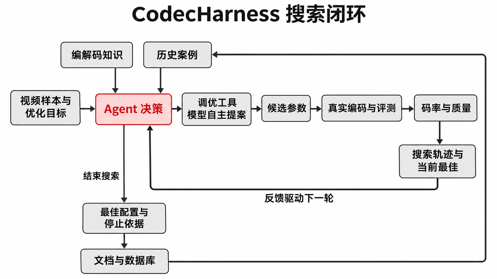

# CodecHarness

由知识、真实编码反馈与跨样本记忆驱动的编码参数优化 Agent。

**Code coming soon.** [项目主页](https://tzhsw.github.io/codec-harness/)

在画质下限、码率上限和计算预算给定时，应该先试哪组编码参数？CodecHarness 根据视频特征、编码器知识和历史实验提出候选配置，实际运行编码器，再用测得的码率和 VMAF 决定下一轮尝试。项目关注的是，积累其他视频的经验之后，能否用更少的试验找到满足相同约束的配置。

## 公开资料

| 入口 | 内容 |
| --- | --- |
| [技术博客](https://tzhsw.github.io/codec-harness/article.html) | 从一次参数搜索出发，介绍候选如何生成、实测结果如何反馈，以及经验如何跨视频复用。 |
| [项目演示](https://tzhsw.github.io/codec-harness/slides/) | 在线阅读系统架构、x265 参数空间和配对实验结果，也可[下载 PDF](https://tzhsw.github.io/codec-harness/slides/2026-11-19-codec-harness.pdf)。 |
| [实验记录](https://tzhsw.github.io/codec-harness/workbench/) | 在交互式工作台切换任务、组别和轮次，查看实测码率、VMAF 以及实际生效的参数变化。 |

## 实验看什么

- **画质达标时最小化码率。** 固定 VMAF ≥ 90，在 50 轮实测中寻找满足画质要求的最低码率。[查看逐轮记录](https://tzhsw.github.io/codec-harness/workbench/?run=market)
- **码率受限时最大化画质。** 固定码率上限 397.305 kb/s，在 50 轮实测中比较合规配置的 VMAF。[查看逐轮记录](https://tzhsw.github.io/codec-harness/workbench/?run=drive)
- **比较跨视频经验对搜索的影响。** 空记忆组和使用十条训练片经验的组，在同一视频、同一码率上限下各搜索 10 轮。街景案例中，经验组第 4 轮超过了空记忆组第 10 轮的最佳画质；桥面车流案例中，对应轮次为第 3 轮和第 9 轮。[街景对照](https://tzhsw.github.io/codec-harness/workbench/?run=street-memory) · [桥面车流对照](https://tzhsw.github.io/codec-harness/workbench/?run=bridge-memory)



## 站点目录

GitHub Pages 从 `main` 分支的 [docs/](docs/) 发布。首页、技术博客和样式位于该目录，配图在 [images/](docs/images/)，演示文稿在 [slides/](docs/slides/)，交互工作台和公开实验数据在 [workbench/](docs/workbench/)。

本地预览可在仓库根目录运行以下命令，然后访问 <http://127.0.0.1:8000/>。

```sh
python3 -m http.server 8000 --bind 127.0.0.1 --directory docs
```
